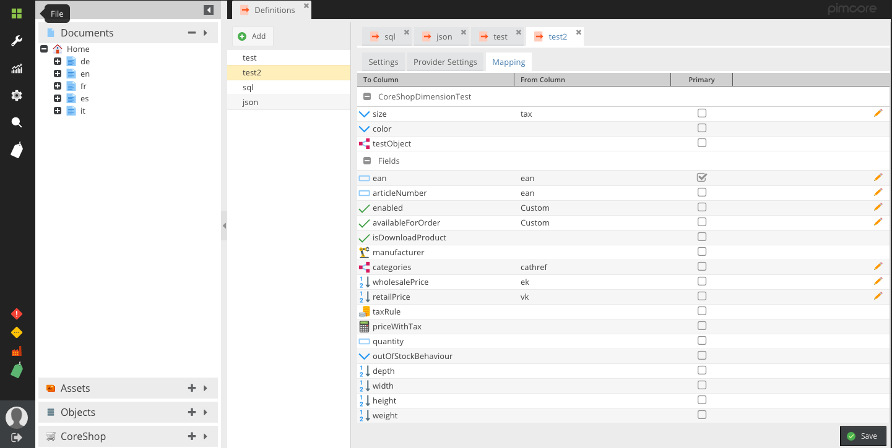

[](LICENSE.md)
[](https://packagist.org/packages/instride/data-definitions)

Data Definitions allows you to define your DataObject Imports and Exports using a nice GUI and re-run the definitions
as often you like. Everything within Data Definitions is extendable.



## Requirements
* Pimcore 5.8 or 6.x
* Pimcore X (since Version 4.0)

## Getting started/Installation
 * Install via composer  
 ```composer require instride/data-definitions```
 * Enable via command-line (or inside the pimcore extension manager)  
 ```bin/console pimcore:bundle:enable DataDefinitionsBundle```
 * Install via command-line (or inside the pimcore extension manager)  
 ```bin/console pimcore:bundle:install DataDefinitionsBundle```
 * Reload Pimcore
 * Open Settings -> Import Definitions or Export Definitions

## Documentation
 - [Import Definitions](./docs/imports.md)
 - [Export Definitions](./docs/exports.md)

## License
**instride AG**, Sandgruebestrasse 4, 6210 Sursee, Switzerland  
[www.instride.ch](https://www.instride.ch), support@instride.ch  
Copyright © 2019 instride AG. All rights reserved.

For licensing details please visit [LICENSE.md](LICENSE.md) 
